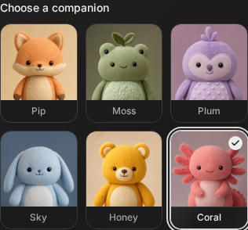

# Web design system

The Tailwind theme in `apps/web/src/index.css` defines the color, radius and width tokens. Use `Page`, `Button`, `Card`, `Input`, `Textarea`, `Segmented`, `Toggle` and `Sheet` from `components/ui.tsx` before adding a local style.

## Page layout

`Page` puts the title, optional action and content inside the same frame. The frame is centered in the **available workspace**, not the browser window. The gutter grows from 16 to 48px. Do not add another centered wrapper or horizontal page padding inside it.

| Screen                    | Layout rule                                                                                                                              |
| ------------------------- | ---------------------------------------------------------------------------------------------------------------------------------------- |
| Search                    | Reading page. Align the heading, field, hint and results to the same left edge.                                                          |
| Feed                      | Reading page. Stack cards under the heading.                                                                                             |
| Goals                     | Reading page. Keep the entry field, plan button and goal list in one column.                                                             |
| Ideas, Spaces and Library | Collection page. Align the first grid column and filters with the title. Put page actions in the header's action slot.                   |
| Settings                  | Collection page. Place navigation and settings side by side from `md`; allow only the navigation strip to scroll horizontally on phones. |
| Chat and side chats       | Full-height conversation. Use `chat-frame` for the message column and composer; the header and navigation are separate surfaces.         |
| Open space                | Full-width canvas, not a reading page. Wrap toolbar controls and let the embedded app use the remaining height.                          |
| Onboarding                | One centered, padded card per step; allow vertical scrolling on small screens.                                                           |
| Voice and overlays        | Voice uses the viewport. Keep sheets bounded by its width and scroll their contents, not the underlying page.                            |

Reading content is capped at 48rem, collections use the 68rem page frame, and conversations cap at 45rem. Switching page types should not shift a standard page's left edge. Use the Tailwind spacing scale: 2 for controls in a group, 4 for card grids, 6 for sections, and 8 for desktop page-header separation.

## Materials and interaction

- Keep the workspace canvas, surfaces, borders and text neutral charcoal and silver. Reserve color for meaningful details such as links, status and avatars, not background washes.
- Use `workspace-canvas` for the background. Use `glass` for chrome: rails, toolbars, the composer and sheets. Create the glass effect with blur and a faint white rim, not a colored tint. Don't stack blur on every card.
- Use opaque `bg-surface` for reading and editing. Pair `text-ink` with primary content, `text-muted` with supporting text, and `text-highlight` with selected controls. Use `border-edge` for boundaries.
- Use `rounded-control` for fields, `rounded-card` for content, and fully rounded buttons for actions. Keep a visible focus indicator. Label icon-only controls and expose the active navigation item or segment to assistive technology.
- Use `AvatarPicker` for companion choices. Show the actual portrait and name, not a substitute icon. Pair the selected border with a checkmark and a pressed state; let the container width determine whether three or six portraits fit per row.
- Glass has an opaque fallback when blur is unavailable or reduced transparency is requested. Don't rely on translucency, motion or color alone to communicate state.

Before shipping a layout change, check phone, tablet and wide desktop widths. Check that the page title and first control share a left edge, that horizontal scrolling stays inside intentional strips, and that long content remains reachable with the agent panel open.

### Companion picker on a phone

## Motion

[Watch the companion selection, page change, and library sheet transitions](media/workspace-motion.gif).

Use Framer Motion's `m` components under `AppMotion`. Pages and steps enter immediately with a 180ms fade and a 6px rise. Slide overlays from the edge they occupy; use `AnimatePresence` when they need to finish an exit. Use the shared `settle` spring for direct feedback on presses, switches, and selection indicators.

Animate new chat bubbles once, not historical messages or streaming text updates. Keep keyboard focus, selection state, and resource cleanup independent of animation completion. Reduced motion should apply changes immediately, including when the system preference changes while the app is open. Leave color changes and small loading spinners in CSS rather than adding animation components to every element.
